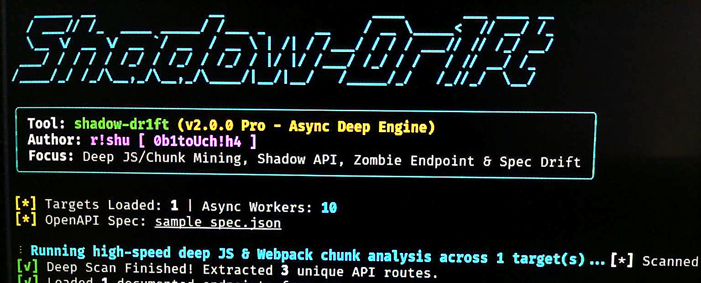

<div align="center">



# shadow-dr1ft (v2.0.0 Pro)

**Created by:** `r!shu [ 0b1toUch!h4 ]`  
**Domain:** Web Application Penetration Testing (WAPT) | Bug Bounty Recon | API Security


*A high-speed, asynchronous CLI reconnaissance and differential analysis tool designed to uncover **Shadow APIs**, **Zombie Endpoints**, **Hidden Parameters**, and **HTTP Method Drift** from live frontend JavaScript and Webpack chunks.*

</div>

---

## Why `shadow-dr1ft`? (Bug Bounty & WAPT Impact)

Modern web applications (React, Next.js, Vue, Angular) frequently ship updated frontend JavaScript bundles while backend API documentation (`swagger.json` / `openapi.yaml`) lags behind. Instead of noisy directory brute-forcing, `shadow-dr1ft` performs **differential analysis** between live client-side code and official API specifications to pinpoint high-value **P1/P2 attack surfaces** that other hunters miss:

* **Shadow APIs:** Internal or undocumented endpoints (`/api/internal/...`, `/api/export`) active in production JS bundles but missing from official API docs—often lacking proper authorization checks (**IDOR / BOLA**).
* **Zombie APIs:** Deprecated API versions (`/api/v1/...`) left running alongside newer versions (`/api/v2/...`), frequently missing modern rate limits or security patches.
* **HTTP Method Drift:** Endpoints documented only as `GET` in Swagger, while frontend code invokes `DELETE`, `PUT`, or `PATCH` (**Broken Function Level Authorization / Privilege Escalation**).
* **Hidden Parameter Mining:** Extracts sensitive payload and query keys (`role`, `isAdmin`, `apiKey`, `user_id`, `debug`) directly from minified JS chunks (**Mass Assignment**).

---

## How It Works (5-Stage Workflow)

1. **Async JS & Chunk Discovery:** Uses `asyncio` + `httpx` to fetch target HTML, extract inline `<script>` blocks, download primary JS bundles, and recursively discover secondary Webpack/Vite chunk files.
2. **Deep Route & Method Mining:** Scans minified JS code for REST paths, full API URLs, GraphQL endpoints, and associated HTTP verbs (`GET`, `POST`, `PUT`, `DELETE`, `PATCH`).
3. **OpenAPI / Swagger Parsing:** Parses local or remote `JSON` and `YAML` OpenAPI specifications, automatically resolving `basePath` prefixes.
4. **Smart Path Normalization & Diff Engine:** Normalizes dynamic path variables (`/users/101`, `/users/${id}`, `/users/{userId}` -> `/users/{param}`) to eliminate false positives before classifying anomalies.
5. **Structured Terminal UI & JSON Export:** Renders color-coded tables in the terminal and exports clean, parseable JSON reports (`-o`).

---

## Full Installation & Environment Setup (Kali Linux)

Follow these exact steps from start to finish to set up `shadow-dr1ft` inside a clean Python virtual environment on Kali Linux:

```bash
# 1. Clone the repository
git clone https://github.com
cd shadow-dr1ft

# 2. Create and activate a Python virtual environment
python3 -m venv venv
source venv/bin/activate

# 3. Install shadow-dr1ft and its dependencies inside the venv
pip install --upgrade pip
pip install .

# 4. Verify the installation
shadow-dr1ft --help
```

*(Note: Whenever you open a new terminal session, activate the environment using `source ~/shadow-dr1ft/venv/bin/activate` before running `shadow-dr1ft`.)*

---

## Usage & Demo Commands (`example.com`)

### 1. Deep JS & Webpack Chunk Discovery (No Spec Required)
Extracts all hidden API routes, HTTP methods, and sensitive parameters from frontend bundles and secondary chunks:
```bash
shadow-dr1ft -u https://example.com -c 20
```

### 2. Differential Drift Analysis (JS vs. Live OpenAPI/Swagger Spec)
Compares live frontend JS routes against an official Swagger/OpenAPI URL to flag **Shadow APIs**, **Zombie APIs**, and **Method Drift**:
```bash
shadow-dr1ft -u https://example.com -s https://example.com -c 20
```

### 3. Drift Analysis with Local YAML/JSON Spec & JSON Export
Compare against a local `openapi.yaml` file and export clean findings for reporting:
```bash
shadow-dr1ft -u https://example.com -s openapi.yaml -o example_findings.json
```

### 4. Authenticated Dashboard Scan (Custom Headers / Cookies)
Scan private user or admin dashboards after logging in to uncover privileged JS bundles:
```bash
shadow-dr1ft -u https://example.com \
  -H "Authorization: Bearer YOUR_JWT_TOKEN" \
  -c 10
```
*(Or using a session cookie: `-H "Cookie: session_id=YOUR_SESSION_COOKIE"`)*

### 5. Mass Subdomain & Asset List Scanning (`-l`)
Scan hundreds of live URLs concurrently with zero lag:
```bash
shadow-dr1ft -l live_urls.txt -s swagger.json -c 25 -o mass_report.json
```

### 6. Unix Pipeline Integration (`stdin`)
Chain `shadow-dr1ft` directly with `subfinder` and `httpx` in your recon pipeline:
```bash
subfinder -d example.com -silent | httpx -silent | shadow-dr1ft -c 25
```

---

## CLI Options Reference

| Flag | Long Flag | Description |
| :--- | :--- | :--- |
| `-u` | `--url` | Single target URL (e.g., `https://example.com`) |
| `-l` | `--list` | Path to a text file containing multiple target URLs |
| `-s` | `--spec` | Path or URL to `swagger.json` or `openapi.yaml` |
| `-H` | `--header` | Custom HTTP header (can be used multiple times) |
| `-c` | `--concurrency` | Number of concurrent async workers (default: `20`) |
| `-o` | `--output` | Save clean results to a `.json` file |

---

## Post-Scan Manual Exploitation Guide (What to Do After Running the Tool)

`shadow-dr1ft` pinpoints the exact hidden attack surface. Once you have the results table, load the flagged endpoints into **Burp Suite Repeater** and test for the following vulnerabilities:

1. **Testing `SHADOW API` Findings (IDOR / BOLA & Broken Auth):**
   * **Broken Authentication:** Strip the `Authorization` or `Cookie` header and resend the request. If data is returned without auth, report as Broken Access Control.
   * **IDOR / BOLA (P1):** Swap object identifiers (e.g., change `/api/internal/user/102` to your second test account ID `101`) to verify unauthorized cross-account data access.
2. **Testing `ZOMBIE API` Findings (Legacy Flaws):**
   * Send requests to deprecated `/api/v1/` routes uncovered in JS chunks. Check if modern security controls (rate limiting, OTP verification, or field-level permissions) are missing compared to `/api/v2/`.
3. **Testing `METHOD DRIFT` Findings (Privilege Escalation / BFLA):**
   * If the spec only allows `GET` on `/api/users/{id}`, send `PUT`, `PATCH`, or `DELETE` requests using a low-privileged user token to test if unauthorized modification or deletion is permitted.
4. **Testing Hidden Parameters (Mass Assignment):**
   * When `shadow-dr1ft` flags parameters like `[Params: role, isAdmin]`, inject `"role": "admin"` or `"isAdmin": true` into JSON `POST`/`PUT` request bodies during profile updates or registration.

---

## Legal Disclaimer

This tool is built strictly for **authorized security assessments, penetration testing, bug bounty programs within defined scope, and educational research**. The author (`r!shu [ 0b1toUch!h4 ]`) is not responsible for any misuse or unauthorized testing.
